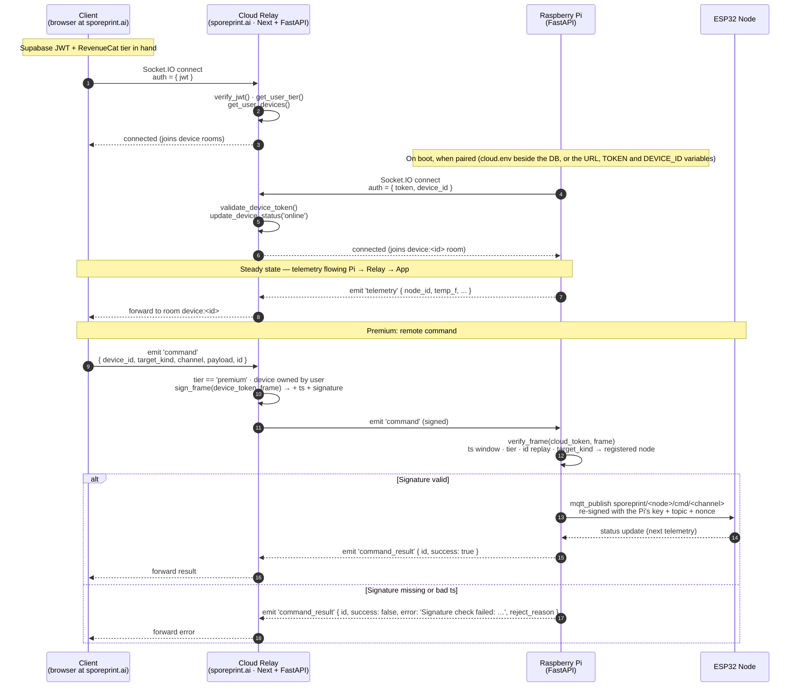

# Cloud Relay Flow

Remote access flow: client (the browser at sporeprint.ai; a React Native mobile app is being rebuilt and not released) → cloud relay at sporeprint.ai → paired Pi on the operator's LAN. v3.3.1 added HMAC-SHA256 signing over the command frames; the Pi refuses unsigned frames.

**v3.4 gating (cloud side)**: the relay refuses a Socket.IO connect whose effective tier is not `premium` — the connect raises `ConnectionRefusedError("subscription_required")`. The sequence below assumes a paying user. A free user never reaches step 1 beyond the refusal handshake. The Pi-side of the flow (steps starting at the `Pi->>Relay: Socket.IO connect`) is unaffected — Pi device-token auth doesn't know or care about mobile-user tier.

**v4 wire shape**: the browser-side Socket.IO client opens a WebSocket to `wss://sporeprint.ai/socket.io/`. The cloud-web Next.js layer's custom `server.js` listens for HTTP-upgrade events on `/socket.io/*` and proxies the WSS handshake to FastAPI on `127.0.0.1:9001` (Next itself listens on `$PORT`, default 9000). A native client would talk to the same URL. From the Pi's perspective, the FastAPI server it talks to is byte-compatible with the v3.x cloud — only the path taken by the *opposite* end of the relay (browser/mobile → FastAPI) changed.



## What the Pi enforces on every cloud command

All in `server/app/cloud/service.py::handle_cloud_command`, in this order:

| Check | Code | Failure mode |
|---|---|---|
| HMAC-SHA256 over canonical JSON, keyed with the Pi's cloud token | `server/app/cloud/signing.py::verify_frame` | `Signature check failed: signature mismatch` (`reject_reason: signature_mismatch`) |
| `ts` within ±30 s of the Pi's clock | same | `Signature check failed: ts outside replay window` (`reject_reason: clock_skew`; fix the Pi's NTP) |
| `tier == 'premium'` | `handle_cloud_command` | `Remote control requires premium tier` |
| `id` present and not seen before | an in-memory FIFO of 1024 ids, written through to the `cloud_command_replay` table so a restart inside the window still rejects a replay | `Replayed command id` |
| `target_kind` is `climate`, `relay`, `lighting`, `camera`, `system` or `automation`; `channel` matches `^[a-zA-Z0-9_-]{1,32}\Z` (the node id and channel syntax, `server/app/node_ids.py`) | `_VALID_TARGET_KINDS`, `is_safe_id` | `Invalid target_kind or channel` |
| A hardware `target_kind` resolves to exactly one registered node: of that type (or role) and, for a channel command, one whose reported channels list the channel (channel names are bank-specific, so `white` finds the lighting node; a node that has not reported its channels counts when it is of that kind). Two or more fitting nodes are refused, never guessed. The node id passes the same pattern | `_resolve_command_node()`, `is_safe_id()`, `_target_is_registered()` | `No registered <kind> node` / `No registered <kind> node has a '<channel>' channel` / `Ambiguous target: …` / `Unknown target '<id>'` |

`system` (automation pause / resume, session start / end, rule suspend,
reboot, Pi OTA) and `automation` (manual overrides) are handled inside the Pi
and never reach MQTT. Before v3.3.1 only the tier string was checked, so a
compromised cloud relay could have issued any command to any registered
target; the Pi now requires a signature it can verify.

- A manual override (`automation` / `override`) pins the node the matching
  hardware command reaches, resolved the same way.
- `system` / `reboot` is refused before the ack where the server cannot reboot
  the host: the Docker install (no sudo, systemd or host access) or a host
  without `sudo` / `systemctl`.

## The Pi → node leg

The cloud never signs node frames itself. After verifying a cloud command,
the Pi publishes it to `sporeprint/<node>/cmd/<channel>` **re-signed with its
own `SPOREPRINT_MQTT_HMAC_KEY`**, and binds two extra signed members: `topic`
(the full destination topic, so the frame can't be redirected to another
channel or node) and a random `nonce` (so identical commands in the same
second aren't mistaken for a replay). Nodes holding the key reject unsigned,
forged, replayed or redirected frames; see `docs/firmware-security.md`.

- A cloud-paired Pi with `SPOREPRINT_MQTT_REQUIRE_SIGNING=auto` (the default)
  refuses to publish unsigned node commands, so it needs a key:
  `install.sh` generates one, `./scripts/provision-node.sh` prints it.
- A cloud OFF to a hardware channel (`state: off`, any case) is published
  without any `pwm`/`level` (older firmware treated `{state:off, pwm:N}` as ON)
  and clears that actuator's `safety_max_on_seconds` ceiling.
- `integrations_request` frames: signed frames are replay-deduped by id (409)
  and a signature that can't be verified gets 401, as does a frame the check
  cannot evaluate. Unsigned frames are rejected (401):
  `SPOREPRINT_CLOUD_REQUIRE_SIGNED_INTEGRATIONS` defaults to `true`, since the
  cloud signs every frame. With it set to `false`, unsigned frames are
  accepted until the Pi verifies its first signed one; that latch resets on
  `/api/cloud/configure`. A rule created or updated this way gets the same
  checks as the Pi's rule editor (422).

## v4 cloud-side rechecks (before forwarding any command)

The cloud relay does its own enforcement before signing + forwarding. These
rechecks happen on every inbound `command` from a client, and while the relay
fans a device's frames out to a client that only listens:

| Check | Frequency | Failure mode |
|---|---|---|
| Tier recheck (effective tier still `premium`) | every 30 s per session, cached | command rejected with `subscription_required` |
| Ownership recheck (`device_id ∈ user's devices`) | every 60 s per session, cached | command rejected with `Device not owned by this user` |
| Session recheck (the client's access token not expired or revoked) | every 60 s per session | the socket is dropped; the browser hands over refreshed tokens (`reauth`) and reconnects with its current one |

The recheck guarantees that a user whose subscription expires mid-session
loses control within 30 seconds (a device removed from the account, within
60 seconds) — they don't keep operating the chamber until they happen to
disconnect. The caches keep the Supabase load bounded; a
hard recheck at every command would 4-10× the auth round-trips during a
busy session.

The Pi side is rechecked too: every 30 s the relay re-validates a connected
Pi's device token and its owner's tier, and drops the socket when either
fails (a rotated or deauthorized token, a lapsed subscription). A database
outage during the check keeps the socket, and a connect whose token or
owner's subscription the relay cannot check is refused with
`service_unavailable`, which the Pi retries like any other failure, keeping
what it buffered (`Invalid device token` is reserved for a token that is
wrong, `subscription_required` for an owner known to have no subscription;
the Pi pauses cloud sync for 15 minutes on those).
A Pi holds one socket: a reconnect drops the older one.

## Grow sessions and contamination events (Pi → cloud, 5.2)

The cloud's sessions, analytics, planner, chamber tiles and contamination
history fill from what the Pi sends here. Before 5.2 nothing sent sessions,
harvests or most contamination events, so those pages stayed empty for a
real grow.

```
Pi: server/app/cloud/session_sync.py
  ├─ session change (create, edit, phase advance, harvest, complete/abort,
  │    its chamber linked, renamed or deleted)
  │    └─ emit "session_sync" { pi_session_id, species_profile_id, species_name,
  │         substrate, status, current_phase, started_at, completed_at, totals,
  │         flush_count, quality_rating,
  │         metadata { name, chamber, species {binomial, common},
  │                    phase_entered_at, phase_days_expected },
  │         harvests [{ pi_harvest_id, flush_number, weights, rating, harvested_at }] }
  ├─ contamination event recorded (vision, identify, manual)
  │    └─ emit "contamination_event" { pi_event_id, pi_session_id, source,
  │         classification, confidence, notes, detected_at }
  │    each with an acknowledgement: the relay answers { ok } once it has
  │    written the row; until { ok: true } the id stays in the Pi's
  │    cloud_sync_pending table
  └─ every (re)connect: send what is pending, then re-check the active
       sessions and those from the last year (sessions first), then recent
       events, sending only what differs from what the cloud acknowledged
       since the Pi started
```

- **Idempotent.** The cloud keys each row by the authenticated device and the
  Pi's local id (`pi_session_id` / `pi_harvest_id` / `pi_event_id`), so a
  resend updates the same row. It never takes a row id from the Pi.
- **Durable.** A change made while the link is down waits on disk, so it
  reaches the cloud after a restart too, however old the session is. A
  socket that died without closing takes sends it never delivers, which is
  why only the acknowledgement counts.
- **In order.** The Pi sends one snapshot of a session at a time and the next
  only after the cloud has acknowledged it (a change made meanwhile goes out
  freshly built), and the relay writes a device's snapshots in the order
  they arrive, so the cloud never ends on an older one. An event goes out
  after its session (the cloud links the two); one sent before its session
  was confirmed stays pending and goes again on the next connect.
- **Cheap reconnects.** The first connect after the Pi starts sends every
  recent session and event once; a reconnect sends only what changed.
- **Sources.** `vision` and `identify` arrive as `claude`, and `manual` as
  `manual`.
- **No duplicates.** The vision `contamination_alert` event carries the
  recorded event's `pi_event_id`, so the cloud stores the detection once.
- **Premium.** Like every persisting relay handler, both are kept only for a
  premium owner.
- **Offline.** A Pi with no cloud configured sends nothing. Its first connect
  after pairing backfills.

## OTA progress events (Pi → cloud, v4)

A Pi self-update reports each step upstream so cloud-web can render a real progress bar instead of a "wait 30 s and pray"
spinner.

```
Pi: server/app/cloud/ota.py
  └─ _emit_step(step, version, channel, …)
       steps: download_started {url} → download_complete {size_bytes}
              → verify_complete {verified_by: manifest | legacy_signature}
              → extract_complete {files_extracted} → promote_complete
              → restart_initiated   (or failed {failed_at, error} at any step)
       └─ forward_event("ota_step", { step, version, channel, … })
            └─ cloud relay: @sio.on("ota_step")
                 ├─ validate step against the same seven names (refuses anything else)
                 ├─ persist to ota_progress_events (Supabase), 10 rows per device
                 └─ emit "ota_step" { device_id, step, payload } to the device room
```

A progress emit never fails the update: a Pi that cannot reach the cloud
still completes its OTA.

`_promote` and `_restart_unit` are separate steps so `promote_complete` ships
before systemd restarts the server. Nothing resumes a failed restart: the new
tree is already live, so a restart by hand (or the next boot) finishes the
update, and an OTA re-sent for the same version runs the whole pipeline
again. Every run extracts into a fresh `staging/<version>.<random>` directory
and never deletes the tree `current` points at, so a failed or interrupted
extraction leaves the running install intact. After a promote the Pi keeps
the new tree and the one it replaced (for a manual rollback) and deletes older
staging trees and the downloaded release files.

OTA releases are Ed25519-signed (`generate-ota-keypair.py` +
`sign-ota-bundle.py` in `sporeprint/scripts/`; the private release tooling
signs and publishes them). Each release has a signed
manifest, `{version}.manifest.json` + `.manifest.json.sig`: canonical JSON
`{schema, artifact, version, channel, sha256, size, published_at}`, defined in
`server/app/cloud/ota_manifest.py` and pinned by
`server/tests/fixtures/ota_manifest_vectors.json`. The Pi checks it against
its locally pinned key before downloading the bundle. A key the cloud puts in
the command (`ota_pubkey`) is ignored.

```
Pi: ota.run_ota_update(version, channel)
  ├─ validate: format · channel == SPOREPRINT_OTA_CHANNEL · not older than installed
  ├─ manifest: fetch .manifest.json + .sig → Ed25519 over the exact bytes →
  │            canonical form → artifact/version/channel match → anti-rollback
  ├─ download: bundle, capped at the signed size
  ├─ verify:   sha256 + size == manifest   (verify_complete: verified_by)
  └─ stage (fresh dir) → promote (records the anti-rollback floor,
     prunes older trees) → restart
```

The release also keeps publishing the legacy `{version}.tar.gz.sig` (a
signature over the bundle bytes only) so Pis from before signed manifests
can still update. A current Pi uses it only when a release has no manifest
(HTTP 403/404/410) **and** `SPOREPRINT_OTA_ALLOW_LEGACY_SIGNATURE=true`. A
manifest that exists but has no signature, a bad one or the wrong contents
fails the update and never falls back.

Limits of Pi self-update:
- The Docker install refuses a `system/ota` command (`success=false`, "Pi
  self-update is not supported in the Docker deployment"); update a Docker Pi
  on the Pi with `git pull && ./install.sh`. Self-update needs the bare-metal
  `<SPOREPRINT_INSTALL_ROOT>/current` symlink layout.
- A command for a channel other than the Pi's `SPOREPRINT_OTA_CHANNEL`
  (default `stable`), or for a version lower than the installed one or the
  floor recorded by the last OTA, is refused before it is acknowledged. Only
  `SPOREPRINT_OTA_ALLOW_DOWNGRADE=true` on the Pi allows a downgrade; the
  command cannot. Pre-release suffixes are not ordered (X.Y.Z only). Only one
  OTA runs at a time.
- No revocation: any genuine release on the Pi's channel that is not older
  than the install can still be requested, including a pulled one. Remove a
  bad release from the release host.

## External services referenced in this flow

- **Supabase** — JWT + user↔device mapping
- **Firebase FCM** — native push for the mobile app once it ships (not shown; nothing receives it today)
- **Browser push services** — browser notifications from `sporeprint.ai` for subscribers (Web Push with VAPID keys, through the browser maker's push service; not shown)
- **RevenueCat** — tier source (webhook updates `profiles.tier`)
- **Anthropic** — Claude vision / grow advisor (separate path, not in this sequence)
